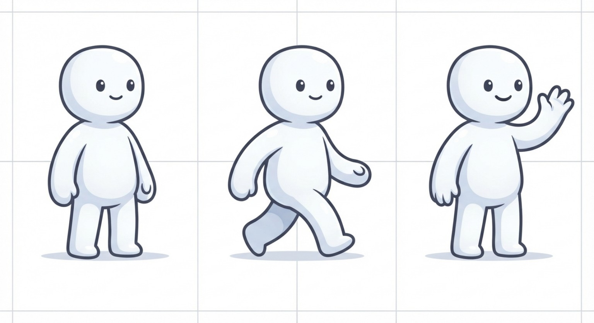

# NPC / Survivor Visual Spec

> Source: `CODE_AFTERmath_ASSET_SPRITE_OBJECT_RULES_UPDATED_v3_SIMPLE_NPC_WORLD_RULES.docx` (converted from the original .docx; content unchanged, only regrouped).
> Part of the CODE: AFTERMATH design set — see [README](README.md).

# 3. NPC / Survivor — APPROVED BASE RULES

| **Rule**                  | **Decision**                                                                                                                       |
|---------------------------|------------------------------------------------------------------------------------------------------------------------------------|
| World gender presentation | Gender-neutral / not visually emphasized in the world sprite.                                                                      |
| Detailed appearance       | Primary detailed appearance belongs to the Survivor Card/Inspector.                                                                |
| Identity                  | Name, gender, age and detailed identity are card/data presentation, not required in the world sprite.                              |
| World body                | Use a standardized survivor body/silhouette system for implementation simplicity and visual consistency.                           |
| World variation           | Limited visual variation is allowed when it improves readability, but must not create a combinatorial equipment problem.           |
| Portrait                  | Separate asset from the world sprite; may show detailed face, hair, gender presentation and personal appearance.                   |
| Equipment display         | Equipment is data/card-first. Active tools/weapons may appear in the world when they are needed to communicate the current action. |
| Card equipment            | The Survivor Card/Inspector may show the complete equipped item set.                                                               |
| Attributes                | Attributes are simulation data and card/Inspector information, not visualized as permanent world overlays.                         |
| Traits/perks              | Card/Inspector information unless a future gameplay rule explicitly requires a world effect.                                       |

# 4. NPC Animation State Rules

| **Category** | **Recommended states**                    |
|--------------|-------------------------------------------|
| Movement     | IDLE, WALK, RUN                           |
| Work         | GATHER, REPAIR, CRAFT                     |
| Survival     | REST, EAT, DRINK, HEAL                    |
| Combat       | GUARD, ATTACK, HIT, INJURED, DOWNED, DEAD |
| Interaction  | INTERACT, PICKUP, DROP, USE_ITEM          |

Not every NPC needs a unique animation for every state. Asset availability is resolved through a documented fallback chain.

# 5. Direction Rules

Use one standardized 8-direction vocabulary:

UP, UP_RIGHT, RIGHT, DOWN_RIGHT, DOWN, DOWN_LEFT, LEFT, UP_LEFT

Every directional animation should use the same naming and ordering convention. The simulation determines direction; the renderer chooses the matching directional animation.

# 6. Animation and Gameplay Separation

- Movement is determined by simulation position and movement state, not by animation playback.

- Task completion is determined by simulation progress, not by the final animation frame.

- Attack resolution is determined by the combat simulation; the attack animation is a visual representation of that event.

- Animation can be interrupted by higher-priority states without changing authoritative state.

- If an animation asset is missing, the renderer uses a defined fallback rather than changing gameplay behavior.

# 7. NPC Sprite Technical Rules

- Use transparent backgrounds for production sprites.

- Use fixed frame dimensions within an asset class.

- Use a standardized world/ground pivot at the character's foot-contact point.

- Keep the character's baseline/pivot consistent across all directional and action frames.

- Do not include labels, UI borders, cards or explanatory text inside production sprite atlases.

- Keep sprite-sheet frame order and naming deterministic.

- Do not mix unrelated asset scales in the same production atlas unless the atlas specification explicitly permits it.

- Master presentation sheets may exist for design review, but they are not the production runtime atlas.

# 8. Modular Appearance Rule

The world NPC should not require a complete unique sprite for every survivor identity. Where modularity is used, the asset system may compose a standardized body with controlled visual layers.

- Base body

- Skin tone, where visually appropriate

- Simple hair/face variation if approved for world readability

- Clothing silhouette

- Action/tool overlay

- Optional damage/status overlay

Detailed gender, face, hairstyle, clothing detail and personal equipment should remain primarily represented by the Survivor Card/Inspector.

# 9. Active Equipment Rule

Equipment is normally card/data-first. However, an active tool or weapon may be rendered in the world when it makes the current simulation action understandable.

| **Action**                  | **World equipment display**                                                                       |
|-----------------------------|---------------------------------------------------------------------------------------------------|
| GATHER                      | Axe/tool overlay may be shown if the action uses one.                                             |
| REPAIR                      | Repair tool/hand-tool overlay may be shown.                                                       |
| FIGHT / ATTACK              | Active weapon may be shown.                                                                       |
| GUARD                       | Weapon may be shown if the guard behavior uses one.                                               |
| INVENTORY / CARRY           | Exact item list remains card/Inspector information.                                               |
| PASSIVE ARMOR / SMALL ITEMS | Card/Inspector by default; world display is optional and should not multiply sprite combinations. |

# 10. Survivor Card / Inspector Rules

The Survivor Card is the authoritative presentation layer for personal identity and detailed equipment information.

- Name and identity

- Gender presentation

- Detailed portrait/appearance

- Health, hunger, thirst and energy

- Attributes

- Traits/perks

- Equipment

- Inventory

- Current task

- Relevant backstory or summary

The card reads from the same underlying GameState/character data used by the simulation; it is not a second independent character record.

# A. REQUIRED VISUAL CONCEPT CHANGES

- Keep NPC world sprites gender-neutral and standardized as previously approved.

- Do not create unique world sprites for every survivor statistic, occupation, trait or equipment combination.

- Use Survivor Cards/Inspector for detailed identity, gender presentation, appearance, attributes, traits, inventory and full equipment.

- Allow only the active tool/weapon or other immediately relevant action equipment to appear in the world when it improves action readability.

- Building level must have meaningful visual states where level changes are intended to be visible.

- Events should be represented through world-readable event states, markers, group movement, effects and UI/event panels without making visuals authoritative.

# B. NPC VISUAL STATE UPDATE

- World sprite communicates movement and immediate action.

- Survivor Card communicates identity and detailed personal information.

- Occupation should not require a unique full-body sprite for every job.

- Traits and numeric attributes should not become permanent world overlays.

- Active equipment may be rendered only when needed to explain the current action.

- Event participation may use a subtle state indicator or event UI rather than creating many new sprite variants.

# NPC SKILL PROGRESSION — VISUAL RULE UPDATE

Skill progression is gameplay state and should not create a separate sprite for every skill level. The world should remain visually readable while the Survivor Card/Inspector communicates detailed progression.

## 1. Skill Levels Do Not Automatically Create New NPC Sprites

- Farming Level 1 and Farming Level 80 may use the same base survivor world sprite.

- Do not create unique full-body assets for every occupation or skill level.

- Skill values, XP, specialization and detailed progression belong primarily in the Survivor Card/Inspector.

- World animation should communicate the current action, such as GATHER, PLANT, HARVEST or REPAIR.

## 2. Optional Mastery Visual Indicators

If later desired, high-level mastery may receive a small, controlled visual indicator, badge, UI effect or building/workstation feedback. Such indicators must not multiply the sprite asset count or become the source of gameplay truth.

- Prefer UI badges or card indicators.

- Avoid permanent skill-number overlays above NPCs.

- Avoid separate sprite sets for every skill tier.

- Use semantic visual states only when they improve player understanding.

## 3. Animation and Skill Relationship

Skill progression may change which actions an NPC can perform and how efficiently those actions resolve, but animation remains a presentation layer.

- Simulation determines that an NPC is harvesting.

- Renderer selects the harvest animation.

- Simulation determines task duration, output and XP.

- Animation does not determine XP, task completion or skill level.

## 4. Asset Architecture Rule

The asset resolver should use semantic action/state identifiers rather than skill-level-specific hard-coded image paths. This keeps the visual system scalable as more skills, occupations and specializations are added.

## 5. Design Decision Status

APPROVED WORKING RULE: NPC skill progression is primarily a data/UI state. World sprites remain compact and action-focused. Detailed skill level, XP and specialization are shown through the Survivor Card/Inspector unless a future visual rule explicitly introduces a limited mastery indicator.

# APPROVED NPC REFERENCE STYLE — SIMPLE, LOW-COGNITIVE-LOAD WORLD SPRITES

The uploaded rounded humanoid reference is adopted as the baseline visual language for survivor/NPC world sprites. It is a style reference, not a final runtime atlas.

Approved visual reference — simple rounded survivor/NPC body style

## 1. NPC Reference Style Rules

- Simple rounded humanoid body with a clean silhouette and minimal visual noise.

- Neutral presentation in the world; do not require gender-specific world sprite sets.

- Friendly/readable proportions are preferred over realistic anatomy.

- Use pose and animation to communicate action instead of detailed anatomy or clothing.

- Keep baseline, foot-contact point and approximate body scale consistent across frames.

- Detailed face, gender presentation, hairstyle, identity and full equipment belong primarily in the Survivor Card/Inspector.

- The reference style should remain easy to animate, recolor, layer and replace.

## 2. Production Asset Philosophy

- Reference sheet is not the production atlas. Design sheets may contain labels; runtime atlases should not.

- Production sprites use transparent backgrounds, fixed frame dimensions and deterministic ordering.

- Do not create a unique full-body sprite for every survivor identity.

- Do not create unique sprites for every occupation, skill level, trait or inventory combination.

- Use a small modular vocabulary: base body, limited appearance layer, action/tool overlay and optional status overlay.

## 3. Recommended Core NPC Animation Set

- IDLE — 4 frames

- WALK — 6 frames

- RUN — 6 frames

- GATHER / WORK — 6 frames

- REPAIR — 6 frames

- CRAFT — 6 frames

- EAT — 6 frames

- DRINK — 6 frames

- REST — 6 frames

- ATTACK — 6 frames

- GUARD — 6 frames

- HIT / INJURED — 3 frames

- DOWNED — 4 frames

- DEAD — 4 frames

- INTERACT / PICKUP / DROP / USE_ITEM may be reusable action animations rather than occupation sprites.

## 4. World Map Visual Rules

- Use a 2D top-down / god-eyes simulation view.

- Player is the observer/controller and can see NPC actions and surrounding activity.

- Base layout: square fence, central HQ, housing/tent, ruined storage shade, gate and path to the forest.

- Outside area: trees, stones, huntable animals and a scavenging ruin.

- Keep terrain distinct enough for beginner understanding without requiring highly detailed environmental art.

- NPCs remain visually prominent through consistent scale and readable silhouettes.

- World objects are semantic and data-driven; visual changes do not alter simulation rules.

## 5. Building Visual Rules

- Buildings may be more visually detailed than NPCs because upgrades should be immediately understandable.

- Meaningful building levels use distinct assets.

- Major states may include RUINED, DAMAGED, REPAIRED and ACTIVE where useful.

- Do not create an asset for every health percentage.

- World renderer, Building Tree and Upgrade UI use the same building definitions.

- Recommended pattern: building\_\<type\>\_lv\<level\>\_\<state\>.

## 6. World Object Rules

- Resources: final visual taxonomy remains open until gathering and regeneration rules are finalized.

- Materials: primarily inventory icons and simple world representations where necessary.

- Consumables: primarily card/inventory icons; world representation only when gameplay readability benefits.

- Weapons/tools: show active equipment during relevant world actions; complete details remain in inventory/card UI.

- Scavenge sites, resource nodes and event locations use simple state changes rather than many unique variants.

## 7. NPC Skill Progression — Visual Rule

- Skill XP and skill level are simulation/UI data, not reasons to create new full-body sprites.

- A Farming Level 1 and Farming Level 80 survivor may use the same base world sprite.

- Mastery may later receive a small UI badge or controlled effect if it improves readability.

- Do not place permanent skill numbers above NPCs unless a future lesson specifically requires it.

## 8. Player Accessibility / Cognitive Load Rule

- The world should answer: Who is here? Where are they? What are they broadly doing? Is something important happening?

- Do not force learners to memorize dozens of sprite IDs.

- Do not make visual customization a prerequisite for writing basic commands.

- Use Survivor Cards for detailed inspection and the world map for immediate simulation awareness.

- Prefer consistent visuals over excessive realism.

## 9. Asset Combinatorics Control

Preferred architecture:

6.  Standardized base survivor body

7.  Optional limited appearance layer

8.  Semantic action animation

9.  Optional active-tool overlay

10. Optional status/damage overlay

11. Separate Survivor Card/Inspector assets for detailed identity

## 10. Design Status / Open Categories

- APPROVED: simple rounded NPC reference style.

- APPROVED: gender-neutral world NPC baseline.

- APPROVED: detailed identity and equipment are primarily card-first.

- APPROVED: 2D top-down observer/god-eyes world presentation.

- APPROVED: buildings visibly change at meaningful upgrade levels.

- OPEN: exact production atlas dimensions and final frame counts.

- OPEN: final building level taxonomy.

- OPEN: enemy body taxonomy and Screamer/special variant rules.

- OPEN: resource-node visual taxonomy and depletion/recovery visuals.

- OPEN: material, consumable and weapon icon standards.

- OPEN: final event-marker and world-object visual language.
